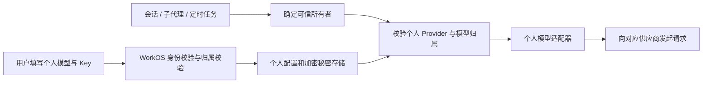

# 个人模型与 API Key 管理设计草案

状态：方案设计，尚未实现。根据当前插件代码和本机 DSH 0.2.0-rc.2 的接口审查编写。

## 推荐方案

在「设置 > 模型」中提供个人模型管理，使用插件自己的服务、存储和模型路由。所有角色，包括 owner/admin，遵守相同的个人配置归属规则。个人配置不通过全局 Settings 文档和默认环境变量存储。

“单向保存”定义为产品接口只接收秘密字段，不提供读取原值的接口。API Key 必须如此。地址和真实模型 ID 默认也采用此规则，列表和会话选择器仅显示用户自行填写的名称；如后续选择允许本人查看地址和模型 ID，只放宽这两类字段的读取规则。

API Key 不能做不可逆哈希后丢弃原值，因为模型调用必须把有效 Key 发送给用户配置的供应商。服务端使用可解密的加密存储，仅在向对应供应商发起请求时使用原值。产品内的管理员没有查看他人原值的权限；掌握服务器和解密主密钥的部署维护者仍处于信任边界内。

## 现有实现需要补齐的环节

| 位置 | 当前行为 | 目标行为 |
| --- | --- | --- |
| `src/model-scope.js` | 多个过滤函数对管理员直接返回全部数据，允许未加用户前缀的共享 Provider | 私人 Provider、模型及状态对所有角色都只属于本人；个人模型功能默认不开放共享路由 |
| `src/service.js` 的 `patchCredentialProvider` | 个人凭据不存在时回退到未加用户前缀的凭据；无请求身份时使用全局解析 | 私人路由缺少身份或凭据时拒绝调用，后台任务按可信任务/会话归属解析 |
| `patchSettings` / `patchApiProxy` | 重写成员配置路径，但管理员绕过部分规则，仍依赖共享 Settings 命名空间 | 用专用个人配置 API 和存储，个人字段不进入全局 Settings 原始文档 |
| `patchSessionController` | `selectModel` 和 `prompt` 主要检查会话归属，未在该包装中检查所选私人 Provider/模型归属 | 选择、发送及真正向供应商发请求前均检查会话、Provider、模型的归属 |
| `src/policy.js` / `src/service.js` | 存在用户 Key 存储与按会话取 Key 的辅助服务；单凭这些方法不能证明真实模型调用已使用它们 | 建立真实调用闭环，用两用户并发请求验证各自使用正确的 Key |
| `src/storage.js` | 本地存储没有加密参数时允许明文保存 | 新的个人秘密存储必须加密；缺少有效主密钥时拒绝保存秘密 |

以上是代码审查发现的规则和接入缺口，不代表已完成跨用户泄露的实测。

## 页面与交互

用户填写供应商显示名称、协议、API 地址、API Key，以及一个或多个模型的显示名称和真实模型 ID。第一阶段支持 OpenAI 兼容协议和手动填写模型 ID，覆盖 DeepSeek 及常见兼容服务；其他协议通过适配器逐步加入。

保存后，列表仅显示本人设置的名称、启用状态、凭据是否已配置、最近更新时间。Key 输入框立即清空，重新打开表单显示“已配置，留空保持原值”，没有“显示原 Key”或复制原 Key 的操作。

严格模式下，地址和真实模型 ID 同样不回填；编辑时可只修改显示名称，或明确选择替换连接信息。留空不代表删除，清除 Key、删除模型和删除供应商使用独立操作。更换地址或协议时，要求重新提交 Key，避免把原来保管的 Key 发送到新地址。

每个模型可以启用、停用、设为个人默认模型。停用或删除后，后续调用明确提示模型不可用；不自动换用他人的模型或平台 Key。测试连接由服务端执行，返回经过净化的成功/失败状态，不回传上游原始请求、响应或异常对象。

## 数据与 API

所有记录以 `(organizationId, userId, providerId)` 或 `(organizationId, userId, modelRef)` 为归属键。`organizationId` 和 `userId` 只能来自经过验证的 WorkOS 身份，不接受浏览器指定目标用户。Provider 和模型使用服务端生成的随机标识，用户可填写相同的显示名称而互不影响。

记录分成可返回的个人展示信息与加密私密配置：

| 可返回给本人的信息 | 仅供服务端使用的信息 |
| --- | --- |
| providerId、modelRef、自定义名称、enabled、keyConfigured、revision、updatedAt | API Key、真实 API 地址、真实模型 ID、敏感连接参数 |

建议新增以下个人 API，统一要求登录身份，写操作验证同源/CSRF，返回 `Cache-Control: no-store`。跨用户随机 ID 使用一致的“不存在”响应，避免通过错误信息探测其他用户配置。

| 接口 | 用途 |
| --- | --- |
| `GET /auth/my-model-providers` | 返回本人的展示信息和配置状态 |
| `POST /auth/my-model-providers` | 创建供应商、Key 及模型配置 |
| `PATCH /auth/my-model-providers/:id` | 修改本人配置；携带 expectedRevision，冲突则拒绝覆盖 |
| `PUT /auth/my-model-providers/:id/key` | 替换 Key，只返回配置状态 |
| `DELETE /auth/my-model-providers/:id/key` | 清除 Key，后续调用不可继续使用它 |
| `POST /auth/my-model-providers/:id/test` | 用已保存配置进行服务端连通性测试 |
| `DELETE /auth/my-model-providers/:id` | 删除本人供应商及关联模型 |

模型列表、增删改和个人默认模型可作为上述供应商资源的子资源。不存在返回原始秘密配置的 GET 接口。PATCH 只接受明确允许的字段，不接受任意 Settings 路径或对象整体替换。

## 真实调用闭环

建议新增 `UserModelService`、`UserModelRepository` 和 `TenantModelAdapter`。复用 WorkOS 身份、Session 所有权和现有加密工具，但个人秘密与通用租户状态分开存放。

DSH 当前公开接口提供 `registerAdapter`，模型请求的 `GenerateOptions` 有由 loop 写入的 `sessionId`，可以作为接入个人模型适配器的基础。会话记录和模型目录中保存随机 modelRef 和显示名称，真实模型 ID 在适配器内部转换，API Key 不进入会话消息、请求头快照或 Agent 提示词。

不能只包装 `llm.stream`：DSH 还存在 `prepareCall(...).stream(...)` 的预备调用链。最终授权检查应放在个人适配器发起请求的边界，覆盖直接和预备调用。适配器是否能复用已有供应商实现，先用实际宿主做最小接入验证；首期不要承诺所有供应商协议自动兼容。

调用规则：交互请求先验证当前用户能访问该 Session，再验证所选 Provider/模型也属于该 Session 所有者。子代理沿用经过登记的会话归属；定时任务从已认证创建者记录取得身份，执行时重新检查配置仍有效。标题生成、上下文压缩、重试等辅助调用也须携带同一归属。无 Session 的内部调用只能使用显式的可信用户执行上下文，缺失时拒绝使用私人 Key。

不能仅依靠 HTTP 请求期间的临时身份，也不能按浏览器传来的 userId、可猜测的 Provider 前缀或全局环境变量确定 Key。缓存键必须包含组织、用户、Provider 和配置版本；每次新调用检查启用状态与当前版本，防止替换/删除后继续使用旧 Key。已发出的上游请求可能已被处理，删除不能撤回已产生的使用量。

## 存储与泄露防护

秘密字段使用 AES-256-GCM 加密，随机 nonce，密文绑定组织、用户、Provider 和格式版本等关联数据。采用随机主密钥和 keyId 支持轮换，主密钥与密文分开管理。复用本地/D1 存储选型时，新增个人记录读写接口，避免每次修改重写所有用户的完整租户状态。

本地模式用受限权限目录和文件、串行写入及原子替换；如多进程共用存储则增加跨进程协调或改用数据库。数据库模式使用参数化查询和版本条件更新，确保 Key 与关联配置不会因并发编辑发生不一致。保存成功必须意味着持久化成功；恢复后重新构建个人路由。

Key 不进入共享 `.env`、可供 Agent 读取的工作区、浏览器持久化缓存、日志、审计记录和错误响应。审计只记录操作者、资源随机 ID、操作、时间和结果。供应商测试/模型发现请求也遵守这些规则。

自定义供应商地址会导致服务端带 Key 向该地址发请求，因此要校验 HTTPS、禁止 URL 中携带用户名密码，限制回环、内网、链路本地和云元数据地址；限制重定向并防止 DNS 解析与连接之间的地址变化。需要内网供应商时，由部署管理员显式配置允许目标，默认不接受任意内网地址。更换地址不沿用原 Key。

加密、日志净化和密钥生命周期参考 [OWASP Secrets Management](https://cheatsheetseries.owasp.org/cheatsheets/Secrets_Management_Cheat_Sheet.html) 与 [Cryptographic Storage](https://cheatsheetseries.owasp.org/cheatsheets/Cryptographic_Storage_Cheat_Sheet.html)。自定义地址控制参考 [SSRF Prevention](https://cheatsheetseries.owasp.org/cheatsheets/Server_Side_Request_Forgery_Prevention_Cheat_Sheet.html)。

## 实施顺序与验收

1. 做真实宿主接入验证：两个用户配置同名供应商/模型，向测试上游同时发请求，验证各自 Key、模型和地址正确；涵盖预备调用与后台任务。
2. 实现独立存储、只写秘密字段 API、最终调用归属检查，并关闭私人路由的共享 Key 回退。
3. 接入个人模型页面、个人目录和默认模型，支持保存、替换、清除、测试连接、停用及删除。
4. 迁移旧个人配置：只迁移能证明归属的用户命名空间记录；全局共享 Key 不自动变成个人 Key，无法证明归属的配置由本人重新填写。验收迁移后旧 Settings/凭据文件不再残留可回读的个人秘密。

至少验证以下场景：A/B 同名配置并发互不串用；B 和管理员无法读写或调用 A 的资源；伪造 Provider/modelRef、直接 RPC、历史会话和修改默认模型均不能绕过；缺少 Key 不回退；重启、Key 替换/清除、并发编辑和后台调用正确；列表/保存响应/错误/日志/浏览器缓存不包含原 Key；严格模式下不返回真实地址与模型 ID；地址更换和恶意目标不能带走旧 Key。

验收以实际浏览器加实际 DSH 调用链为准，不能只通过名称过滤和纯函数测试认定完整隔离已实现。
