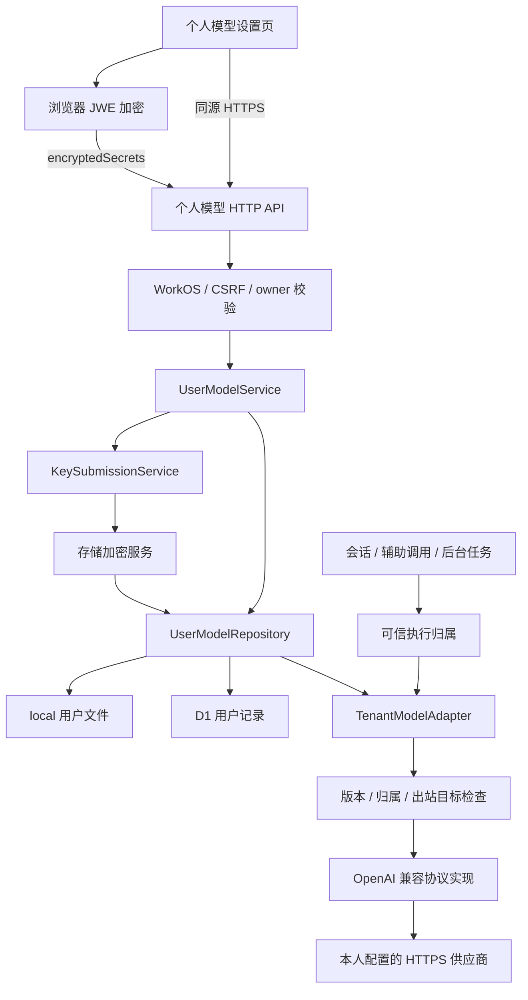
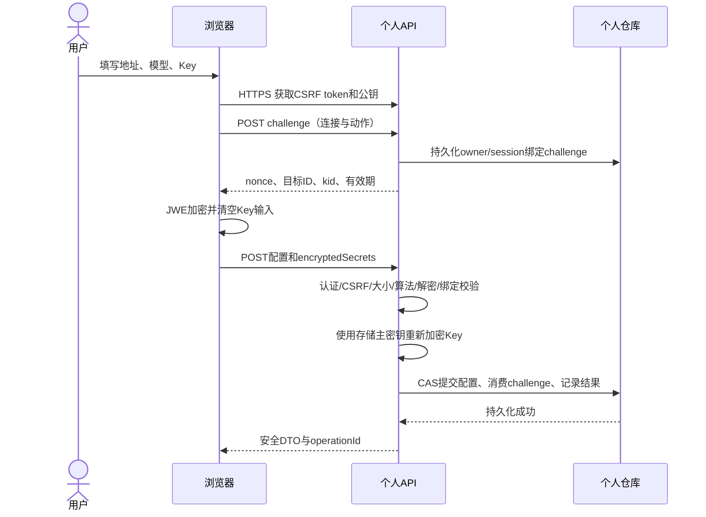

# 用户个人模型与 API Key 管理详细设计

版本：v1.0，2026-10-12。状态：待实现、待真实宿主验证。

本文将[方案概述](./user-model-credentials-design.zh-CN.md)细化为开发与验收契约。接口、文件名、配置项和示例类型均是拟新增设计，不表示当前版本已支持。宿主依据本机安装的 DSH `0.2.0-rc.2`；密码协议依据文末标准资料。

## 1. 目标与首期范围

用户在设置中管理自己的供应商、API Key 和模型。配置归属始终为经过 WorkOS 验证的 `(organizationId, userId)`，组织相同不代表配置共享，owner/admin/member 对私人资源适用相同规则。

| 项目 | 首期决策 |
| --- | --- |
| 供应商协议 | OpenAI 兼容 Chat Completions；手动填写 API Base URL 和真实模型 ID |
| 个人配置 | 多供应商、每供应商多模型、启停、个人默认模型、连接测试、删除 |
| 回显规则 | 本人可读供应商地址、协议、真实模型 ID；API Key 永不回显，也不显示末几位 |
| 提交加密 | 浏览器 JWE 公钥加密，再通过同源 HTTPS 提交；拒绝明文入口 |
| 存储加密 | 服务端独立主密钥 AES-256-GCM；主密钥缺失时功能不可写、不可调用 |
| 使用隔离 | 目录过滤、选择检查、最终出站检查同时实施；私人路由没有全局 Key 回退 |
| 存储方式 | 沿用部署选择的 local 或 D1；新增独立个人仓库，不能静默切换后端 |
| 延后能力 | 模型自动发现、未保存 Key 的草稿测试、自定义认证头、OAuth、其他供应商协议、模型共享、团队 Key |

首期先保存再测试，减少秘密入口。将来新增草稿测试和模型发现时，必须复用相同的加密接收、一次性凭据和出站校验，不能引入明文旁路。

兼容协议不等于兼容全部功能。首期必须验证文字流式输出、工具调用与取消；图片、推理参数、缓存、上下文能力等只按已验证能力声明，不根据用户填写的模型 ID 猜测。

## 2. 安全边界与不可破坏的规则

1. 浏览器、HTTP 参数、RPC 参数和模型提示词提供的用户 ID 都不是授权依据。
2. 产品管理员可以管理平台设置，但不能读取、修改、删除或调用他人的私人配置和 Key。现有 `adminCanManageKeys` 不适用于新仓库。
3. 随机 Provider/modelRef 和名称前缀只是标识，不构成权限。所有资源查询都带完整组织、用户条件。
4. API Key 不进入响应、日志、审计、会话日志、提示词、共享 Settings、环境变量、工作区文件或浏览器持久化缓存。
5. 加密不能替代身份验证；公钥是公开的，任何人都能生成密文。
6. 凭据丢失、停用、删除、配置变化、身份不明确或存储不可用时，私人调用明确失败，不切换到平台 Key。
7. 写入成功只能在持久化成功后返回；不能复用当前 `TenantPolicy.persist()` 的异步忽略失败语义。

保护对象是其他用户、产品管理员、被动网络监听以及正常转发链路中采集请求体的代理。服务器进程、提交解密私钥和存储主密钥的维护者属于可信部署边界。恶意终端、XSS、能替换页面或公钥的主动代理、用户主动向不可信供应商提交 Key，不能靠本方案彻底防止。服务端必须短暂处理原 Key，供应商也会收到其有效认证凭据。

## 3. 总体架构



职责拆分：

| 模块 | 职责 | 不承担的职责 |
| --- | --- | --- |
| `UserModelHttpController` | 路由、认证、CSRF、输入大小和结构校验、响应白名单 | 不把任意请求体直接传到 Settings |
| `UserModelService` | 资源归属、版本、默认模型、原子业务更新、DTO 投影 | 不返回秘密对象 |
| `KeySubmissionService` | 公钥发布、challenge、固定 JWE 解密、绑定检查 | 不接受外部 JWK/JWKS 地址 |
| `UserModelCrypto` | 存储秘密封装/解封、AAD、keyId 和轮换 | 不复用短口令派生或明文降级 |
| `UserModelRepository` | 按 owner 读写、CAS、持久化、操作结果记录 | 不调用模型供应商 |
| `TenantModelAdapter` | DSH 路由、固定配置代际、调用前检查 | 不把地址和 Key 写回宿主全局配置 |
| `SafeProviderTransport` | HTTPS、DNS/IP 校验、超时、重定向控制、出站认证 | 不信任用户传入的 Host/Authorization |

## 4. DSH 接入设计

### 4.1 页面入口

首期注册独立 `settings.section`，`id=user-models`，显示名称“个人模型”。登录后所有角色可见，普通成员只看到该页面，管理员可同时看到平台管理页面。供应商和模型列表不依赖原生 Models 页的全局 Settings 数据。

选择独立 section 的原因：当前原生设置导航通过原始 `slots.entries("settings.section")` 生成，而渲染使用已决胜的贡献；同 ID 覆盖 `models` 可能产生两个导航项。独立 ID 避免这个兼容问题，也不依赖 CSS 隐藏原生编辑器。

相应调整现有 `installSettingsVisibility`：

- 已登录租户成员：只允许 `user-models`，替换目前仅允许 `models` 的判断。
- 已登录管理员：保留平台设置；移除原生 `models` 入口，由 `user-models` 管理个人模型。
- 未认证或身份正在确认：不挂载个人配置表单，不请求私人目录。
- WorkOS 未启用的本地模式：保留原宿主行为，个人租户功能不启用。
- 退出、切换组织、切换用户：清空个人 DTO 缓存、表单、请求和订阅，不能短暂展示上一用户的数据。

原生模型 onboarding 同样从租户入口移除，改为个人模型为空时显示“添加个人模型”。卸载插件时恢复全部 slot 包装和监听。

`settings.models.provider-card` 和 `settings.models.footer` 可用于增加内容，但不足以替换原生全局保存路径，所以本功能不以它们作为秘密编辑入口。

### 4.2 会话选择器与宿主 API

个人目录通过 owner 过滤后的 LLM API 提供，选择器接收 DSH 所需的 `provider`、`model` 和显示名；provider route、modelRef 为随机稳定标识，真实模型 ID 只在私人详情和出站适配器使用。

示例：`provider=up_<随机标识>`、`model=um_<随机标识>`。两人配置同名供应商、同名模型时 route 仍不相同。不能只让列表隐藏，仍必须拒绝直接选择他人的 route。

现有 `patchLlm`、`patchApiProxy`、Settings/credentials 包装需要补充私人路由规则：管理员也过滤他人的私人条目；私人模型配置不接受通过通用 Settings、credentials RPC 创建或修改；纯全局平台设置的管理权限仍按原规则处理。

任何能返回全局 Provider 注册表、模型目录、能力信息、默认模型或状态的 HTTP/RPC/推送接口都要投影为当前用户可见数据。宿主原始 Settings 不保存这些私人记录。全局 route 元数据使用中性名称，不能把个人地址和真实模型 ID 装入 `providerInfo`。

具体覆盖现有 `apiProxy.llm.providers`、`apiProxy.llm.models` 和 `apiProxy.sessions.models`。目录从本人仓库构建并映射到宿主格式，不能只过滤原生列表，因为私人配置不在原生 Settings 命名空间。`groups` 使用随机 route、本人显示名和随机 modelRef；`routableProviders` 只含本人可用 route；`failures` 只含本人净化错误；`default` 只取个人有效默认引用。没有有效默认时显式移除该字段，不能用对象展开保留全局 default，也不能像现有过滤函数那样自动选择首个模型。新会话创建入口同步阻止宿主默认回退，要求用户选择可用个人模型。

### 4.3 模型适配器

通过公开 `llm.registerAdapter(routes, adapter)` 注册私人路由，配置变更使用注册 handle 更新。使用 `LlmAdapter` 的 `providerInfo`、`listModels`、`resolveModel`、`prepareCall` 和 `stream`，不修改上游 DSH 源码。

实现时新增 `@deepseek-ai/dsh-llm` 的运行时导入，并验证 peer 版本。当前声明支持 `>=0.2.0-rc.1 <0.3.0`，但目前仅审查了 rc.2；不能仅凭版本范围声称 rc.1 已兼容。

`GenerateOptions.sessionId` 是会话归属查询入口，不是调用者授权证明。必须先保证 HTTP/RPC 的会话入口已验证当前登录用户。无 sessionId 的标题、一次性请求等只能使用服务端生成的可信执行上下文，缺失时失败。

`prepareCall` 返回的闭包固定 provider/model 配置代际，但不固定明文 Key。stream 时重新检查有效性和版本；若 prepare 后配置改变，返回 `MODEL_CONFIG_CHANGED`，重新准备请求，不混用旧能力与新连接。每次重试都经过出站校验；不能仅包装 `llm.stream` 而遗漏 `prepareCall(...).stream(...)`。

## 5. 页面交互与状态

页面结构：顶部“添加供应商”；供应商卡片展示名称、启用状态、Key 是否已配置和更新时间；展开显示本人地址、协议和模型列表；每个模型显示自定义名称、启用状态与默认标记。

表单字段与校验：

| 字段 | 规则 |
| --- | --- |
| 供应商名称、模型名称 | 去除两端空白，1–80 个 Unicode 字符；渲染为文本 |
| 协议 | 首期只允许 `openai-compatible` |
| API Base URL | 最多 2048 UTF-8 字节；HTTPS；不允许 userinfo、query、fragment；保留合法路径前缀 |
| API Key | 去除两端空白后 1–4096 字节；首期 Bearer Key 使用可打印 ASCII，拒绝控制字符 |
| 真实模型 ID | 1–256 UTF-8 字节，拒绝控制字符；允许常见斜杠、冒号和连字符 |
| 数量 | 每 owner 最多 20 个供应商，每供应商最多 20 个模型；按部署可调 |

以上数量与大小是产品设计限制，不是 DSH 或 D1 平台上限。

模型还需填写经用户确认的上下文/输出 token 上限，或者选择经过验证的模板。未知容量不伪造为确定值；若宿主运行必需且模板不能提供，要求填写后再启用。工具/图片等能力默认不声明，按适配器实测和模板开启。

### 5.1 新增、编辑与替换

- 新建必须填写 Key、至少一个模型；保存后模型默认启用。首次创建不自动设为默认，用户显式选择。
- 编辑回填名称、地址、协议、模型 ID；Key 输入保持空白，提示“已配置，留空保持原值”。
- 单改名称、模型 ID、启停等使用普通配置 PATCH；Key 留空不清除，也不发送空 Key。
- 换 Key 使用独立操作；输入框支持用户查看当前输入，但永不展示已保存的 Key。
- 改地址/协议必须同时重新填写 Key，以一个原子更新完成；不能先 PATCH 地址后复用旧 Key。
- 清除 Key 使用独立确认操作；清除后供应商不可调用，模型配置保留。
- 删除供应商展示受影响模型数；提交后移除该供应商所有模型和默认引用。

### 5.2 状态与错误

表单状态为 `loading → editing → encrypting → saving → saved/error`。加密和保存期间禁用重复提交，取消/卸载时终止尚未完成的客户端请求。明文仅留在当前未提交表单；加密成功立即清空输入引用，提交失败需要重新填写 Key。

普通字段提交冲突时保留当前普通字段草稿，重新读取最新版本供用户比对，不能覆盖别的浏览器修改。网络中断导致保存结果未知时，使用本次 operationId 查询结果，不能自动再次替换 Key。

测试连接先选择一个已保存模型，显示“测试可能产生少量费用”，点击后调用服务端，结果仅为成功、认证失败、模型不可用、超时、供应商不可达或受策略限制。测试结果记录其 configRevision，配置变化后旧结果标为过期，不参与权限判断。

### 5.3 默认与历史会话

个人默认模型只影响之后的新会话；新建会话时从 owner 的偏好读取，并重新检查模型可用。既有会话固定自己的随机 modelRef，不随默认设置改变。

停用、清 Key 或删除默认模型时，同时清空默认引用。用户必须重新选择，系统不自动选择另一个付费供应商。历史会话保留原 modelRef，恢复时如果不可用，明确提示用户切换模型。

## 6. 数据模型

### 6.1 标识与版本

`owner` 仅服务端构造；Provider、modelRef、operationId 和 challengeId 采用密码安全随机标识。Provider route 全局唯一，模型引用在生命周期内不复用，删除后重建也生成新 ID。

使用三类版本：

| 版本 | 变化条件 | 用途 |
| --- | --- | --- |
| `stateRevision` | 同一 owner 的任意持久化更新，包括 challenge 与操作结果 | 仓库 CAS，避免覆盖并发写入 |
| `configRevision` | 供应商普通配置、模型、Key、启停发生变化 | 表单 expectedRevision 与调用代际 |
| `secretRevision` | 替换或清除 Key | 存储 AAD、秘密生命周期和缓存失效 |

修改默认模型另有 `preferencesRevision`，不强迫修改供应商版本。签发 challenge 不增加 configRevision，否则会使正在编辑的表单无故失效。

### 6.2 逻辑类型

```ts
type Owner = { organizationId: string; userId: string }

type StoredSecret = {
  format: 1
  keyId: string
  iv: string        // base64url，随机 12 字节
  ciphertext: string
  tag: string       // base64url，16 字节
}

type UserProvider = {
  providerId: string
  route: string
  displayName: string
  protocol: 'openai-compatible'
  baseUrl: string
  enabled: boolean
  configRevision: number
  secretRevision: number
  secretCipher: StoredSecret | null
  models: UserModel[]
  createdAt: string
  updatedAt: string
}

type UserModel = {
  modelRef: string
  displayName: string
  upstreamModelId: string
  enabled: boolean
  contextTokens: number | null
  maxOutputTokens: number | null
  capabilities: { tools: boolean; images: boolean }
}

type KeyChallenge = {
  challengeId: string
  nonceHash: string
  sessionBinding: string
  owner: Owner
  kid: string
  purpose: 'create-provider' | 'replace-key' | 'replace-connection'
  providerId: string
  expectedRevision: number
  connectionDigest: string
  expiresAt: string
}

type CompletedOperation = {
  operationId: string
  requestDigest: string
  action: KeyChallenge['purpose']
  providerId: string
  configRevision: number
  completedAt: string
}

type UserModelState = {
  schemaVersion: 1
  owner: Owner
  stateRevision: number
  preferencesRevision: number
  defaultModelRef: string | null
  providers: UserProvider[]
  challenges: KeyChallenge[]
  operations: CompletedOperation[]
}
```

`secretCipher`、challenges、operations 和 owner 不经通用对象序列化返回。DTO 使用明确字段列表构造；`keyConfigured` 由 `secretCipher != null` 得出。无必要不缓存解密后 Key，只缓存无秘密 DTO 或存储密文。

普通配置同样是私人数据，由产品接口授权保护。存储中的名称、地址、模型 ID 可为普通字段，目录/数据库访问受部署权限保护；API Key 必须始终为密文。掌握底层数据库的维护者并不等同于产品管理员。

### 6.3 Challenge 与操作结果

KeyChallenge 保存 `challengeId`、随机 nonce 的 SHA-256 摘要、登录会话绑定摘要、owner、kid、purpose、providerId、expectedRevision、connectionDigest、expiresAt。绑定摘要不使用浏览器可指定的 userId，也不向前端输出登录 Cookie/token。

`connectionDigest` 为固定字段对象的确定性编码后 SHA-256，字段为 `{v, protocol, normalizedBaseUrl}`。只使用明确字段顺序和编码，不直接哈希任意 JSON 文本。提交修改后的连接必须与签发 challenge 的连接一致。

CompletedOperation 保存 `operationId`、请求摘要、动作、资源 ID、结果版本、完成时间。只保存安全结果，不保存 Key、解密内容或 JWE 原文。秘密提交的 operationId 直接使用 challengeId；请求摘要为 HTTP 方法、规范路径、经过白名单规范化的普通配置及 JWE 字符串摘要的确定性编码后 SHA-256。同 owner、同操作内容的重复请求返回原安全结果，不再修改、不再解密；同 ID 不同摘要返回 409。操作结果只含资源 ID、完成状态和版本，不复用可能包含之后已删除配置的完整详情响应。

challenge 最长 120 秒有效，每登录会话最多 10 个、每 owner 最多 32 个未使用 challenge。操作结果最多保留 24 小时、每 owner 最多 256 条；清理后旧 challenge 仍因不存在或过期而拒绝。结果未知的保存可以通过操作查询确认，不把重新发送当成第二次保存。

## 7. HTTP API 契约

### 7.1 公共约束

所有接口需要有效 WorkOS 会话；写操作需要 `Origin` 精确匹配配置的外部 origin，以及 `X-CSRF-Token`。新增同源 `GET /auth/my-model-csrf` 获取绑定当前登录会话的随机 CSRF token；token 仅在页面内存中保留。生产写入不接受缺失 Origin，不凭 Host 头自行推导可信 origin。SameSite Cookie 只作补充。

接口返回 `Cache-Control: no-store`，拒绝跨域 credential CORS。写入只接受 JSON，无 multipart、表单编码或 URL 查询秘密参数。未知字段、明文 `apiKey`/`authorization`/`headers` 等均拒绝。正文最多 64 KiB，解密秘密 JSON 最多 8 KiB，流式读入超限即中止。

`organizationId`、`userId`、role、共享标记或任意 Settings 路径不是合法写字段。跨 owner 与不存在资源统一 404；未登录 401；CSRF 或传输策略不符 403。资源 ID 在路径中只能出现一次，拒绝多次解码、斜杠注入和额外子路径。

通过 `webServer.register({kind:'prefix', path:'/auth/my-model-providers', handler})` 注册资源路由；公钥、CSRF、challenge、偏好和操作查询使用 exact/prefix 专属路径。路由按方法和规范化路径白名单分发，未知方法返回 405，未知路径返回 404。

### 7.2 接口列表

| 方法与路径 | 请求概要 | 成功结果 |
| --- | --- | --- |
| GET `/auth/my-model-csrf` | 无 | `csrfToken` |
| GET `/auth/my-model-key-encryption` | 无 | 当前 kid、公钥 JWK、固定 alg/enc |
| POST `/auth/my-model-key-challenges` | purpose、目标、连接配置、expectedRevision | challengeId、nonce、providerId、connectionDigest、kid、expiresAt |
| GET `/auth/my-model-providers` | 无 | 本人供应商摘要；不含地址、模型 ID 和秘密 |
| GET `/auth/my-model-providers/:id` | 无 | 本人详情，含地址、模型 ID、版本、keyConfigured |
| POST `/auth/my-model-providers` | providerId、普通字段、models、challengeId、encryptedSecrets | 201，安全操作结果 |
| PATCH `/auth/my-model-providers/:id` | expectedRevision、允许修改的普通字段 | 200，安全详情 |
| PUT `/auth/my-model-providers/:id/connection` | expectedRevision、baseUrl、protocol、challengeId、encryptedSecrets | 200，安全操作结果；原子更新连接与新 Key |
| PUT `/auth/my-model-providers/:id/key` | expectedRevision、challengeId、encryptedSecrets | 200，安全操作结果 |
| DELETE `/auth/my-model-providers/:id/key` | expectedRevision | 200，keyConfigured=false、新版本 |
| PUT `/auth/my-model-providers/:id/models` | expectedRevision、完整模型数组 | 200，安全详情；新增模型 ID 由服务端生成 |
| POST `/auth/my-model-providers/:id/test` | expectedRevision、modelRef | 200，净化后的测试结果 |
| DELETE `/auth/my-model-providers/:id` | expectedRevision | 200，资源 ID 与删除状态 |
| GET `/auth/my-model-preferences` | 无 | defaultModelRef、preferencesRevision |
| PUT `/auth/my-model-preferences` | expectedPreferencesRevision、modelRef 或 null | 200，新偏好版本 |
| GET `/auth/my-model-operations/:operationId` | 无 | 本人的已完成操作安全结果，未找到 404 |

PATCH 白名单限于 `displayName`、`enabled`；模型通过 models 资源整体替换，已有 modelRef 必须属于该供应商，新模型不能自行指定 modelRef。连接地址和协议必须走 connection 操作。任何修改/删除要求版本条件，缺少则 428。

签发 challenge 时，`create-provider` 由服务端分配目标 ID、版本固定为 0；`replace-key` 只接受本人已有 providerId 和 expectedRevision，连接从当前记录读取；`replace-connection` 同时接受新连接并校验目标版本。客户端不能通过 create 复用已有 ID，不能把 replace-key 的 challenge 用于换地址。普通配置的启停和模型更新若使默认模型不可用，必须在同一次状态提交中清空默认引用。

GET 详情的安全 DTO 示例：

```json
{
  "providerId": "up_example",
  "displayName": "我的供应商",
  "protocol": "openai-compatible",
  "baseUrl": "https://api.example.com/v1",
  "enabled": true,
  "keyConfigured": true,
  "configRevision": 1,
  "models": [{ "modelRef": "um_example", "displayName": "我的模型", "upstreamModelId": "example-chat", "enabled": true, "contextTokens": 32768, "maxOutputTokens": 4096, "capabilities": { "tools": false, "images": false } }]
}
```

服务端仍须验证模型 token 上限与适配器能力，不能盲目信任 capabilities。错误、冲突及操作结果的响应均不包含秘密。秘密保存返回 `{operationId, providerId, configRevision, completed:true}`，随后前端读取本人详情；相同操作重试返回 200 和同一安全结果。其他普通配置更新可返回本人的安全详情 DTO。

### 7.3 新增示例

签发 challenge 的请求：

```json
{
  "purpose": "create-provider",
  "connection": {
    "protocol": "openai-compatible",
    "baseUrl": "https://api.example.com/v1"
  }
}
```

服务端响应包含保留的随机 providerId，expectedRevision 为 0，不创建可调用 Provider：

```json
{
  "challengeId": "kc_example",
  "nonce": "<32字节随机数的base64url>",
  "providerId": "up_example",
  "connectionDigest": "<sha256摘要>",
  "expectedRevision": 0,
  "kid": "submit-2026-10",
  "expiresAt": "<服务端时间加120秒>"
}
```

最终保存请求示意：

```json
{
  "providerId": "up_example",
  "displayName": "我的供应商",
  "protocol": "openai-compatible",
  "baseUrl": "https://api.example.com/v1",
  "enabled": true,
  "models": [{ "displayName": "我的模型", "upstreamModelId": "example-chat", "enabled": true, "contextTokens": 32768, "maxOutputTokens": 4096, "capabilities": { "tools": false, "images": false } }],
  "challengeId": "kc_example",
  "encryptedSecrets": "<JWE Compact Serialization密文>"
}
```

所有示例标识、时间和模型能力仅说明格式，不表示实际供应商参数。所有响应通过 DTO 构造，绝不包含 `encryptedSecrets`、secretCipher 或 Key。

## 8. 提交加密协议

### 8.1 密钥与封装

使用标准 JWE Compact Serialization，固定 `alg=RSA-OAEP-256`、`enc=A256GCM`、RSA 3072 位。由维护中的 `jose` 库完成浏览器加密与服务端解密，实施时锁定经过审查且支持当前 Node/浏览器的版本。每次加密生成新的随机内容密钥和 96 位 IV，不重复使用。

公钥接口只发布当前提交用公钥 JWK：`kty`、`n`、`e`、`kid`、`alg`、`use=enc`，及支持的 enc。绝不包含 RSA 私钥字段。私钥不放在 bundle、Settings、租户记录或数据库；由部署秘密文件/秘密管理系统提供，与存储主密钥分开。

JWE protected header 仅允许 `alg`、`enc`、`kid`、`typ`，固定 `typ=dsh-user-model-key+jwe`。拒绝压缩、未知 crit、客户端内嵌 jwk、jku/x5u 与其他密钥发现方式。根据服务端 kid 映射加载本地受信私钥，不读取客户端指定路径。

### 8.2 加密内容

下列 JSON 仅存在于浏览器加密前和服务端解密后，不作为普通请求正文发送：

```json
{
  "v": 1,
  "challengeId": "kc_example",
  "nonce": "<challenge返回的随机值>",
  "purpose": "create-provider",
  "providerId": "up_example",
  "expectedRevision": 0,
  "connectionDigest": "<challenge绑定的摘要>",
  "secrets": { "apiKey": "<用户当前输入的Key>" }
}
```

组织、用户、登录会话和有效期取自服务端 challenge 记录，不让浏览器声明授权目标。nonce 只在浏览器内存与密文内容中使用，服务端记录其摘要。请求外层 challengeId 与密文内层必须相同。

### 8.3 保存顺序



服务端处理顺序：基础认证和大小限制 → 读取当前 owner 状态 → 检查操作是否已完成 → 检查 challenge 存在、有效、owner/session/purpose/目标匹配 → 固定算法解密 → 校验 nonce、连接摘要与配置版本 → 生成存储密文 → CAS 一次提交全部业务变化。

CAS 失败重新读取当前状态：若操作已完成则返回既有安全结果；若业务版本已改变则 409；仅 stateRevision 因其他无关操作改变时最多重试 3 次，并重新校验全部绑定与时间。绝不直接覆盖新版本。

密文篡改、错误 kid、解密或绑定不符统一返回 `KEY_SUBMISSION_INVALID`，不包含密码库异常。challenge 过期可返回专用 `KEY_CHALLENGE_EXPIRED`。失败加限流，不提供解密结果探测接口。

### 8.4 重放与不确定结果

成功保存时，challenge 消费、秘密变更和 CompletedOperation 在同一份 owner 状态提交，保证重复请求不能再次生效。操作查询只返回安全结果。相同密文的网络重试可以得到同一结果，但不会二次保存。

明确持久化失败不返回成功。若数据库/网络超时使结果不确定，先按 operationId 读取确认；仍不明确则返回 `OPERATION_OUTCOME_UNKNOWN`，客户端查询结果并刷新详情，不能自动创建另一份配置。新输入重新申请 challenge；旧 challenge 若仍有效，其对应旧版本在配置更新后也会拒绝。

操作查询的 404 只表示“此刻未找到已完成结果”，不证明另一在途保存永远不会成功。结果未知时页面先等待原操作确认或到期后取得权威状态，再让用户重新输入；不在等待期间自动提交新的创建请求。普通无秘密 PATCH 的网络结果未知也先刷新版本，不自动重放旧编辑。

challenge 仅绑定秘密与连接语义；普通名称、模型数组也受请求摘要及 configRevision 保护。能窃取登录态并修改合法页面的攻击者不属于公钥加密能够单独阻止的范围。

## 9. 存储加密与密钥生命周期

提交密钥负责“浏览器到应用”的加密；存储主密钥负责“服务端长期保管”的加密，两者用途与材料分离。API Key 不能不可逆哈希，因为调用供应商需要原值。

存储使用随机 32 字节主密钥，AES-256-GCM、随机 12 字节 IV、16 字节 tag。AAD 采用固定顺序编码 `{domain:'dsh-user-model-secret', format:1, organizationId, userId, providerId, secretRevision, keyId}`，防止把 A 的密文复制给 B 或复制到另一供应商。

主密钥严格按 base64url 解码并校验长度，不接受“任意字符串 SHA-256 后当密钥”，也不复用 `src/storage.js` 当前缺少密钥即明文保存的路径。解密遇到未知 keyId、格式或认证失败，拒绝使用并给出安全错误，不尝试明文兼容。

明文只在提交处理和出站认证构造阶段使用，不跨请求缓存。JS 字符串无法保证内存立即擦除，因此只承诺缩短引用生命周期、禁用明文转储与持久化；可擦除的 Buffer 使用后清零。崩溃转储和调试采集遵守部署秘密策略。

轮换规则：

| 密钥 | 轮换步骤 |
| --- | --- |
| 提交 RSA 私钥 | 先部署新旧私钥与新公钥；新 challenge 只用新 kid；旧私钥覆盖 challenge 最大有效期与在途窗口后退役 |
| 存储主密钥 | 新写用新 keyId；逐 owner 解密旧秘密并重新封装，通过 CAS 提交；确认线上记录与保留备份的可恢复性后退役旧密钥 |
| 紧急泄露 | 提交密钥泄露撤销关联未使用 challenge；存储密钥泄露还需用户撤销上游 Key，单纯重新加密无法消除已发生泄露 |

备份保存密文；主密钥独立备份并限制访问。Key 清除/资源删除使在线服务立即失效，但历史加密备份可能仍包含旧密文，不声称物理擦除；用户若要求上游彻底失效，应在供应商处撤销 Key。

## 10. 仓库、并发与故障

### 10.1 统一仓库接口

```ts
interface UserModelRepository {
  read(owner: Owner): Promise<UserModelState>
  compareAndSwap(owner: Owner, expectedStateRevision: number,
    next: UserModelState): Promise<'saved' | 'conflict'>
  listRouteIndex(): Promise<Array<{ owner: Owner; route: string }>>
}
```

首次 owner 记录创建也用条件插入；业务服务不能修改 owner。listRouteIndex 只供可信启动阶段重建随机路由索引，不暴露给产品 HTTP/RPC。仓库不能默默吞掉写入错误。

挑战、偏好、供应商与操作结果在同一 owner 状态中，使消费 challenge 和秘密更新可以一次原子提交，不要求跨用户事务。每次仅重写一个用户的状态，首期通过容量上限控制体积；序列化状态最多 512 KiB，超限拒绝写入。

### 10.2 本地文件

独立目录置于工作区之外，例如 `<DSH_HOME>/private/user-models`，目录权限 0700，文件 0600，文件名由 owner 固定编码的 SHA-256 得到。Key 和提交私钥放在另一受限秘密目录，不能保存在用户 Workspace 可读树中。应用权限或沙箱也必须防止 Agent 通过任意路径读到这些位置，仅“放到目录外”不足以形成隔离。

如果宿主的 shell/代码执行工具与保存主密钥的服务使用同一系统身份，且可读取任意宿主文件，文件权限 0600 无法阻止该工具读密钥。此时必须先落实工具沙箱/独立系统身份，或把秘密保管和模型出站移到不可由用户工具访问的独立服务；这属于生产启用门槛，不能靠前端隐藏或加密文件宣称解决。当前设计尚未验证宿主工具的实际隔离边界。

按 owner 串行化全部读改写；写同目录独占临时文件 → fsync 文件 → rename 原子替换 → fsync 父目录 → 发布新内存元数据。rename 前失败保留旧状态；rename 后 fsync/响应失败可能已替换文件，按结果未知处理并读取 operationId/新版本确认，不能谎称完全未写入。临时文件也只能含加密秘密。

local 首期明确只支持一个 DSH 服务进程，启动取得服务级独占锁，检测到另一个活跃实例则拒绝启用私人功能。不能靠单进程 Promise 队列声称支持多进程；共享目录多实例必须采用跨进程锁实现或切换数据库。

### 10.3 D1

新增独立表，不复用当前 `tenant-policy` 整体状态行：

```sql
CREATE TABLE dsh_user_model_state (
  organization_id TEXT NOT NULL,
  user_id TEXT NOT NULL,
  revision INTEGER NOT NULL,
  state_json TEXT NOT NULL,
  updated_at TEXT NOT NULL,
  PRIMARY KEY (organization_id, user_id)
);

UPDATE dsh_user_model_state
SET state_json = ?, revision = ?, updated_at = ?
WHERE organization_id = ? AND user_id = ? AND revision = ?;
```

state_json 中只保留 secretCipher，不含明文 Key。采用参数化 SQL，无触发器干扰 CAS；读取并检查 UPDATE 的实际修改结果，0 行表示冲突。当前 `D1TenantStorage.query()` 只返回 results，新的仓库必须保留 `success/meta` 并处理查询失败，不能把空数组当成写入成功。首次插入使用冲突不覆盖的语义。

首期复用服务器 REST 访问方式。为满足清 Key 和停用后新调用立即受限，私人记录授权读取必须来自 primary，不能使用滞后副本。目前 D1 Sessions API 只面向 Worker binding，不能把 `withSession()` 写进现有 Node REST 代码。首期部署使用经确认无读副本服务的私人数据库；如果无法证明 primary 一致读取，拒绝启用该后端，不能用短 TTL 缓存掩盖问题。

数据库请求失败时读取与调用均失败关闭；不回退到本地旧记录或全局凭据。D1 管理凭据与个人秘密不同，同样仅在服务端。多 DSH 实例的 route 索引用定期同步/受信通知同步，未知本人 route 可以按 owner 重新加载；删除和停用仍以每次出站的权威读取为准。

### 10.4 发布与路由一致性

随机 route 先检查是否符合宿主注册约束；持久化成功后再发布新路由目录，故障时按持久化状态重建。已保存但暂未注册成功的供应商显示“运行时加载失败”，禁止调用；不能假装保存失败而使用户重复创建。

更新已经注册的路由时，旧 adapter 闭包仍可能存在。出站始终检查仓库中的当前 configRevision，因此旧 prepared call 即使仍持有闭包，也不能继续使用已清除的 Key。重启只从持久化状态重建，不根据浏览器缓存恢复路由。

## 11. 最终调用授权与协议适配

### 11.1 可信 owner 的来源

| 场景 | owner 的来源与校验 |
| --- | --- |
| 交互会话 | HTTP/RPC 先验证当前用户可访问 Session；适配器再读已登记 Session owner |
| 子代理 | 由可信创建流程登记；child 与 parent owner 一致，拒绝仅传 parentSessionId 冒充 |
| 定时任务 | 已认证创建时记录 owner；执行时确认任务归属、用户/组织仍有效及资源仍可用 |
| 标题、压缩 | 沿用原会话 owner；没有 sessionId 时用服务端执行上下文 |
| 连接测试 | 当前登录 owner 与目标 Provider/modelRef，使用同一 SafeProviderTransport |
| 内部一次性调用 | 服务端构造的执行上下文；只有浏览器传来的 owner 字段则拒绝 |

可信执行上下文只能通过服务内部闭包/不可序列化能力创建，不能作为可由 RPC 输入反序列化的普通 `{userId}` 对象。AsyncLocalStorage 可帮助传播已验证身份，但不能作为定时执行唯一凭据；延后执行必须重新读取可信持久化归属。

首期后台任务仅在宿主能提供上述创建与执行钩子时开放个人模型；缺钩子的路径报错而不回退到共享凭据。身份失效处理需要与 WorkOS 会话/成员变更接入联动，不能把旧角色快照无限期视为有效权限。

### 11.2 出站检查顺序

1. 取得可信 owner；交互调用还确认当前请求身份与会话 owner 一致。
2. 按 owner 查询 Provider 与 modelRef，拒绝跨用户、任意未登记模型 ID、共享路径和未知 route。
3. 检查 Provider/model 启用、Key 存在、prepared configRevision 与当前一致。
4. 校验目标 URL 与实际 DNS/IP，执行部署网络策略；请求上下文不能覆盖 baseUrl、真实 modelId 或认证头。
5. 解密 secretCipher，按适配器协议构造 Authorization，使用真实 upstreamModelId 发送。
6. 仅输出 DSH 允许的流事件，净化传输错误；释放 Key 引用。

仓库版本检查通过并授予本次 dispatch 时视为调用开始。清除/删除完成后，新 dispatch 与重试都拒绝；已开始的上游请求尽力中止，但无法撤回对方已收到的认证或已产生费用。大文件上传等预请求同样属于出站边界。

### 11.3 OpenAI 兼容实现

实现维护自己的协议桥接，或复用能够证明“每次调用显式注入个人连接与 Key、不读全局凭据”的现有实现。不能为每用户临时改全局 adapter 的 baseUrl/apiKey，也不能在请求期间改 `process.env`。

先用最小宿主实验决定复用路径。需要覆盖 DSH messages/tools 到 Chat Completions 的映射、SSE 分片、多 tool call arguments、usage/finish、取消与安全错误。缺少协议实现不以简单代理字符串转发冒充完整支持。所有 provider HTTP 请求按宿主契约加 `attributionHeaders()`，同时检查这些头不携带秘密或私人配置。

调用配置对象可能已被 DSH 冻结，适配器不得就地改写；在内部构造出站副本，将随机 modelRef 映射为真实模型 ID。共享 token meter、能力查询和状态接口也不得把个人地址/模型元数据广播给所有人。

## 12. HTTPS 与出站地址防护

### 12.1 提交链路

生产页面、公钥和个人 API 必须为有效证书 HTTPS，部署启用 HSTS；Cookie 为 Secure、HttpOnly，并采用合适 SameSite。HTTP 页面禁止输入并提交真实 Key；即便 localhost 被浏览器视为 secure context，首期也不因此放开 HTTP 保存。

反向代理仅允许受信代理地址，应用只在该条件下接受 forwarded 协议；外部 origin 使用部署配置，不依赖不可信 Host。代理到应用使用同机受限链路、TLS 或等效隔离。公钥获取、Web Crypto 或加密失败都不可降级。

正常转发的 TLS 终止代理看到 encryptedSecrets 密文；但能主动篡改网页的恶意代理仍可在加密前窃取输入，因此应用层 JWE 不能替代 TLS 真实性和页面完整性。秘密表单禁用会话回放、第三方输入采集和包含请求体的遥测；产品不承诺拦截器在被控终端上永远无法取到 Key。

### 12.2 用户自定义供应商地址

服务端请求目标需要在保存时和每次实际连接时双重校验：

- 标准 URL 解析，HTTPS，禁止 userinfo/query/fragment；首期端口只允许 443，其他端口由部署 allowlist 开启。
- 检查全部 A/AAAA 结果，拒绝回环、私网、链路本地、云元数据、未指定、多播及其他保留地址，覆盖 IPv4-mapped IPv6。
- 实际 socket 只连接本次已验证的解析地址，TLS 证书与 SNI 仍校验原域名，防止“校验后重新解析”绕过；连接复用也受目标策略约束。
- 不跟随重定向，不把 Authorization 传给新目标；不同 origin 不共用带认证客户端。
- 使用明确的服务端出站代理策略；环境代理不能静默改变已校验路径。代理部署必须证明等效 DNS/IP 约束，否则私人自定义目标禁用。
- baseUrl 路径作为目录前缀精确拼接 `/chat/completions`，不因 URL resolve 的前导斜杠丢失用户路径；禁止路径注入外部 origin。

内网模型通过管理员部署 allowlist 例外，限制域名/IP/端口，仍需 HTTPS、归属和密钥检查。当前项目默认 `network.allowNetworkAccess=false` 的语义不能直接套用为阻止所有模型请求；实现前验证现有网络门禁的范围，个人适配器服从明确的模型出站策略，不能隐式绕过用户网络限制。

连接测试首期发最小推理请求，不用 GET `/models` 成功替代“指定模型和 Key 真能调用”。建议超时 10 秒、输出最多 8 tokens；取消传播到实际 socket。上游 raw body 不写日志、不回传，连通性成功也不保证未来额度和模型永远可用。

## 13. 错误、审计与限制

| HTTP / 内部错误 | 场景 | 产品提示 |
| --- | --- | --- |
| 401 `AUTH_REQUIRED` | 未登录或会话失效 | 请重新登录 |
| 403 `CSRF_INVALID` / `HTTPS_REQUIRED` | 请求不满足提交边界 | 无法安全提交，请检查登录或访问地址 |
| 404 `MODEL_RESOURCE_NOT_FOUND` | 不存在或非本人资源 | 配置不存在或不可访问 |
| 409 `MODEL_REVISION_CONFLICT` | 并发编辑冲突 | 配置已更新，请重新加载 |
| 409 `MODEL_CONFIG_CHANGED` | prepared 配置代际失效 | 配置已变化，请重新发起 |
| 428 `REVISION_REQUIRED` | 修改缺版本 | 重新加载配置后操作 |
| 400 `KEY_SUBMISSION_INVALID` | 解密、算法或绑定无效 | 加密提交无效，请重新输入 |
| 400 `KEY_CHALLENGE_EXPIRED` | 一次性凭据过期 | 请重新提交 |
| 429 `MODEL_OPERATION_RATE_LIMITED` | 超出提交/测试限制 | 操作过于频繁，请稍后重试 |
| 503 `MODEL_STORAGE_UNAVAILABLE` / `MODEL_CRYPTO_UNAVAILABLE` | 存储或密钥不可用 | 个人模型服务暂不可用 |
| 503 `OPERATION_OUTCOME_UNKNOWN` | 无法确认持久化结果 | 正在确认保存结果，请勿重复创建 |
| 内部 `MODEL_DISABLED` / `KEY_NOT_CONFIGURED` | 模型不可用 | 启用模型或重新配置 Key |

response 只含稳定 code、用户可读的固定 message、requestId、必要的安全版本信息；不返回上游 URL、body、request options、headers、SDK cause 或任意异常 message。用户和供应商返回的文本都不能直接拼入日志。

审计记录 actor、组织、动作、随机资源 ID、操作 ID、时间和结果。平台管理员可看到必要的安全操作统计，但不能通过审计读到地址、真实模型 ID 或 Key。监控只聚合失败数量、延迟与错误类别，避免资源内容进入标签。

默认限流建议：challenge 和秘密提交各 10 次/分钟/登录用户，测试 5 次/分钟/用户且同用户最多 2 个并发；解密失败另加 IP 粒度限制。数值是首期产品参数，可配置但不能无限制；多实例时使用共享限流或入口统一限流。

## 14. 配置、迁移与兼容

拟新增部署配置：

```ts
personalModels: {
  enabled: boolean
  externalOrigin: string
  submissionKeys: { activeKid: string; privateKeyFiles: Record<string, string> }
  storageKeys: { activeKeyId: string; keyFiles: Record<string, string> }
  repository: { mode: 'local' | 'd1'; directory?: string }
  outbound: { allowedPrivateTargets: string[]; allowedPorts: number[] }
}
```

这里只声明秘密文件路径，不让产品管理员通过网页读取私钥/主密钥内容。存储模式与现有部署一致，不提供浏览器任意指定密钥路径、数据库或代理地址。具体 Schema 和环境变量名在实现时落实并加入部署文档。

启动检查密钥长度与算法、目录权限、外部 origin、数据库可读写和一致性前提、DSH 适配器与必要 API。检查失败时 feature 不可用；不能部分启用“可填 Key”页面却没有安全保存或调用路径。

旧数据迁移仅接受能证明完整 owner 的记录：

1. 枚举本人已认证命名空间，验证供应商、模型、凭据引用的一致归属。
2. 先备份密文，生成新随机 route/modelRef，通过新主密钥封装秘密并持久化。
3. 校验迁移数据，再更新该 owner 会话中可证明归属的模型引用；无法映射的会话提示用户重新选择。
4. 清理旧 Settings、credentials 和状态文件中的私人秘密，记录安全迁移报告。
5. 全局共享 Key、无可靠归属、管理员代填和无法解密的记录不自动迁入，要求本人重新配置。

不自动上传或尝试连接旧供应商。迁移期间拒绝同 owner 修改，使用迁移标记避免重复执行。失败保留原始密文和报告，不留下新旧路由同时可调用状态。

启用新模式后租户用户不能再通过旧全局模型入口创建私人 Key；关闭新功能也不能恢复旧私人 Key 回退。回滚到不认识新 schema 的版本前必须停止私人调用，不能把新密文导出为明文以求兼容。

## 15. 代码变更清单与实施顺序

拟新增文件：

| 文件 | 责任 |
| --- | --- |
| `src/user-models/service.js` | 业务服务、owner、版本与安全 DTO |
| `src/user-models/http.js` | HTTP 路由、CSRF、限流、错误投影 |
| `src/user-models/submission.js` | JWE、公钥与 challenge |
| `src/user-models/crypto.js` | 存储秘密格式、AAD 与密钥管理 |
| `src/user-models/repository.js` | 统一仓库接口、local/D1 与 CAS |
| `src/user-models/adapter.js` | DSH LlmAdapter、prepare 与 stream |
| `src/user-models/transport.js` | 安全 HTTPS、DNS 与协议出站 |
| `src/client/user-models/` | 个人设置页、API client、浏览器加密和文案 |
| `test/user-models/` | 仓库、权限、加密、真实适配器与接口测试 |

修改现有 `src/service.js` 的服务装配与 runtime guards；`src/auth.js` 提供经验证的身份/登录会话绑定接入；`src/model-scope.js` 区分私人和平台资源并取消私人管理员豁免；`src/client/index.jsx` 挂载个人页面、调整 slot 过滤与 onboarding；更新 `src/index.js`、依赖、bundle、部署文档。已有公开 helper 如保留兼容，不能仍为新个人 API 的绕过入口。

实施分为五个可验证阶段：

1. **宿主接入实验**：两用户各自 route，真实 DSH 普通流与 prepared 流；核对目录/RPC/推送、标题压缩、子代理和任务身份。产出兼容矩阵，确定协议复用实现。
2. **后端安全闭环**：仓库 CAS、双密钥体系、challenge、加密 API、最终出站检查和全局回退封堵；使用模拟上游证明隔离。
3. **产品交互**：个人页面、连接测试、默认模型、表单冲突、退出清理与选择器更新；生成浏览器 bundle。
4. **部署与迁移**：HTTPS/代理、秘密文件、local/D1 故障恢复、迁移工具与回滚开关。
5. **验收发布**：真实浏览器、DSH 和可控上游并发验证，全部必测项通过后开放 feature。

不预先估计固定工期。DSH 没有稳定钩子的后台路径、现有协议实现复用条件和模型能力元数据是第一阶段必须解决的实现门槛；未验证之前不承诺首期覆盖所有宿主调用。

## 16. 验收矩阵

使用 A/B 两个 member、一个 owner/admin、两个组织、可捕获认证信息的隔离测试上游以及真实 DSH。测试 Key 使用专用假值，不使用用户真实秘密。

| 编号 | 验证内容 | 必须结果 |
| --- | --- | --- |
| ISO-01 | A/B 配置同名供应商、模型并同时调用 | 各自地址、真实模型 ID、Key 正确，互不串用 |
| ISO-02 | B 和管理员访问 A 的列表、详情、CRUD、测试、默认资源 | 列表无 A，指定资源统一 404 |
| ISO-03 | 伪造 route/modelRef、直接 RPC、任意未登记模型 ID | 选择与最终调用均拒绝 |
| ISO-04 | 跨组织同 userId、跨用户同名称 | 查询与缓存仍完全隔离 |
| ISO-05 | 缺 sessionId、伪造任务 owner、子代理归属不一致 | 缺可信上下文时拒绝 |
| ENC-01 | 浏览器与正常 TLS 终止代理捕获创建/换 Key 请求 | 秘密字段只有 JWE，无 Key 明文 |
| ENC-02 | HTTP、公钥失败、不支持加密、明文/旧格式提交 | 拒绝，不降级 |
| ENC-03 | 错误 kid、算法降级、zip、jku/x5u、篡改密文 | 净化错误，不取外部密钥 |
| ENC-04 | 过期/跨用户/跨登录会话/跨资源/跨连接 challenge | 拒绝，无写入 |
| ENC-05 | 同一有效密文并发重放 | 最多一次变更，其余相同安全结果或拒绝 |
| STORE-01 | 主密钥缺失、错误、AAD 交换、密文损坏 | 不明文保存，不调用，不回退 |
| STORE-02 | 本地落盘/rename/权限失败，D1 超时/失败 | 无虚假保存成功；结果未知可确认 |
| STORE-03 | 双浏览器配置冲突、两个 challenge 并发 CAS | 不覆盖另一修改；只合法版本成功 |
| STORE-04 | 重启、路线重建、密钥轮换 | 配置可恢复，旧 Key 生命周期正确 |
| CALL-01 | 普通 stream、prepare-stream、重试、标题、压缩 | 均通过同一出站归属检查 |
| CALL-02 | prepare 后修改地址、Key、模型或启停 | 旧调用代际拒绝，重新准备后用新配置 |
| CALL-03 | 清 Key/删除后开始新调用与重试 | 拒绝；在途边界有明确行为 |
| NET-01 | 内网、元数据、IPv6 变体、DNS 重绑定、重定向 | 连接层拒绝，Key 未发到违规目标 |
| NET-02 | 更换地址不提供新 Key | 原子操作拒绝，旧 Key 不外流 |
| UI-01 | 本人编辑、留空 Key、换 Key、清除、冲突 | 本人普通信息可读，原 Key 始终不可读 |
| UI-02 | 切换用户/组织、退出、表单卸载 | 无上一身份数据与秘密缓存残留 |
| UI-03 | 默认模型变更、停用、删除、历史会话 | 仅本人受影响，无自动付费回退 |
| LEAK-01 | 列表、详情、错误、日志、审计、提示词、工作区、存储扫描 | 无假 Key 明文；无他人私人配置 |
| HOST-01 | 原生全局目录/RPC/推送及插件加载、卸载 | 无私人数据旁路；slot 和包装可恢复 |
| HOST-02 | 用户工具尝试读取秘密目录、进程凭据与其他用户文件 | 由沙箱/系统权限阻止；不具备边界时禁止生产启用 |
| MIG-01 | 旧私人、全局和归属不明记录迁移 | 只迁可证明归属数据，旧秘密路径被封堵 |

文档检查不能替代上述安全与行为测试。发布判断依据真实宿主加真实浏览器的请求记录与可控上游证据，不能仅凭纯函数过滤测试认定隔离或加密已实现。

## 17. 标准与依据

- [RFC 7516：JWE](https://www.rfc-editor.org/rfc/rfc7516.html)：密文封装、protected header 与认证加密。
- [RFC 7518：JWA](https://www.rfc-editor.org/rfc/rfc7518.html)：RSA-OAEP-256、A256GCM 的算法定义。
- [jose 官方仓库](https://github.com/panva/jose)：浏览器/Node 的标准 JOSE 实现；实施时审核并锁版本。
- [OWASP TLS 指南](https://cheatsheetseries.owasp.org/cheatsheets/Transport_Layer_Security_Cheat_Sheet.html)：HTTPS、证书与传输真实性。
- [OWASP 存储加密指南](https://cheatsheetseries.owasp.org/cheatsheets/Cryptographic_Storage_Cheat_Sheet.html)：认证加密与密钥保管边界。
- [OWASP SSRF 指南](https://cheatsheetseries.owasp.org/cheatsheets/Server_Side_Request_Forgery_Prevention_Cheat_Sheet.html)：自定义目标校验、DNS 与重定向风险。
- [Cloudflare D1 Query REST API](https://developers.cloudflare.com/api/resources/d1/subresources/database/methods/query/)：参数化查询与 result/meta。
- [Cloudflare D1 读复制文档](https://developers.cloudflare.com/d1/best-practices/read-replication/)：副本可能滞后；Sessions API 当前不提供 REST 接入。

DSH 能力依据本机已安装包的 `dsh-client-ui-settings` slot contract、`dsh-client-ui-settings-general` 导航实现、`dsh-llm` 类型及 `dsh-host-webserver` 路由类型。它们证明存在接入基础，不替代实施阶段对真实调用链、兼容版本与隔离性的验证。
